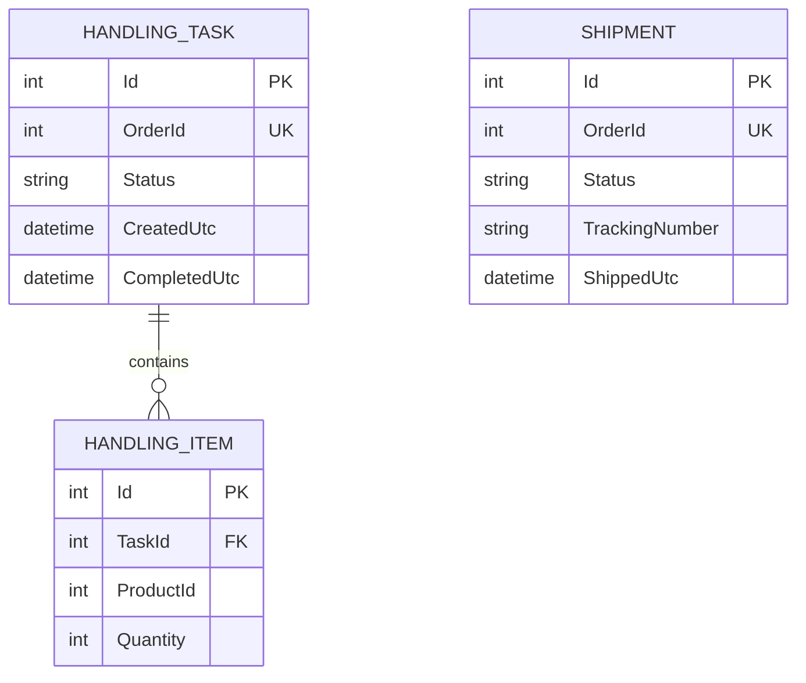

# Chapter 10 · Developing Shipping and Handling Microservices

[All exercise solutions](README.md)

## 1. Shipping and Handling data



Use `HasIndex(x => x.OrderId).IsUnique()` in both local contexts when the business permits only one task and shipment per order. HandlingItem belongs to HandlingTask through a required local foreign key. The unique order reference enforces **at most one** task locally. The event consumer and reconciliation create any missing task. Do not create a foreign key across the Ordering and Handling databases.

## 2. Implement the two consumers

The [chapter's C# implementations](../Chapter%2010/chapter10_code_snippets.md) contain OrderCreatedConsumer and HandlingCompletedConsumer, the entities and all three contracts. Handling copies the order lines to a task, records completion and emits HandlingCompletedEvent. Shipping consumes that event, saves a shipment with a tracking reference and publishes OrderShippedEvent. For this simulation keep the completion step local. For a real warehouse wait for the scanner or operator's completion event.

To make the two examples reliable, configure MassTransit's EF consumer outbox at **both** receive endpoints. Use the endpoint's ConsumeContext for publishing, a unique OrderId, and the same scoped DbContext for business and outbox writes. Move publication before the final save/commit. Test with one order (e.g. 42), then replay it with the same message ID. Verify one completed task, one shipment and one logical OrderShipped outcome. Use shared message contract types on all endpoints: the preceding chapter's illustrative OrderCreated has a different buyer type and lacks the address.

## 3. Correlated state machine

```text
OrderCreated(id) in Initial          -> persist WaitingForHandling(id)
HandlingCompleted(id) while waiting -> persist WaitingForShipping(id)
OrderShipped(id) while waiting      -> persist Completed(id, tracking)
duplicate already-applied event     -> acknowledge without side effects
out-of-order event                  -> retain or retry until prerequisite arrives
```

In a MassTransit state machine correlate all three events on OrderId. With a GUID saga key, keep an additional unique index on OrderId. Persist transitions and outgoing messages together. Retain completed IDs for at least the redelivery window. A unique message ID handles delivery duplicates. A unique OrderId also catches the same business action published twice under different IDs.

## 4. Scale consumers and integrate a carrier

Partition work by order. Increase Handling replicas until queue age falls, then tune prefetch and concurrent messages to available database connections. Measure oldest message age and pick completion latency. Cap Shipping concurrency to the carrier's quota. Use the shipment ID as the carrier idempotency key. After a timeout, look up the existing shipment before requesting another label. Retry 429/temporary 5xx with backoff and honor Retry-After. Route invalid addresses and unknown outcomes to a work queue for manual reconciliation.
