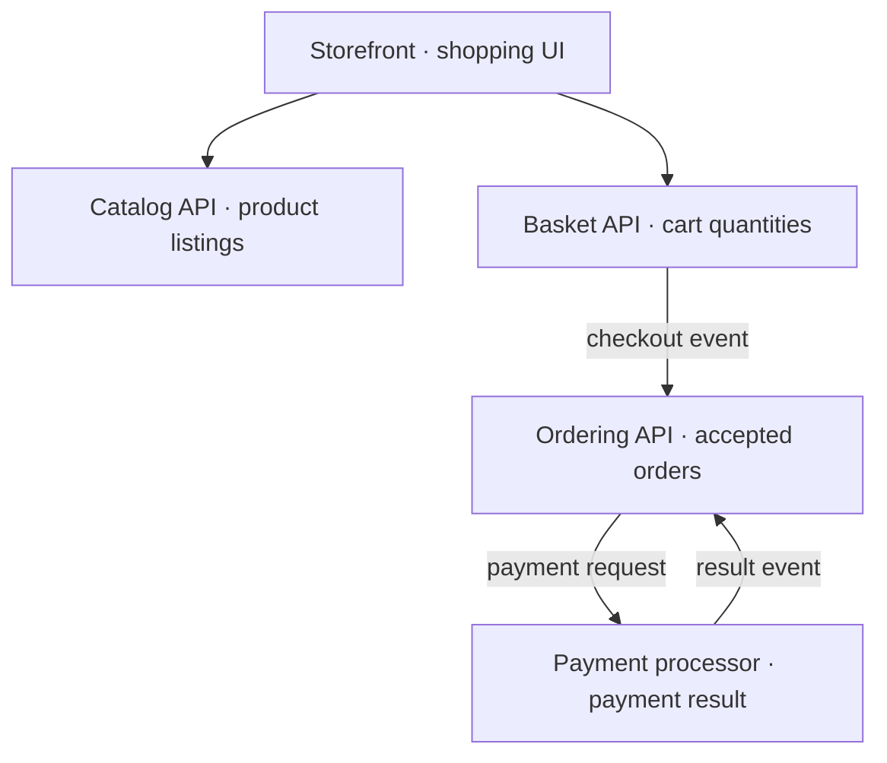

# Chapter 22 · Conclusion and Future Trends

[All exercise solutions](README.md)

## 1. eShop from a reader's perspective

Independent release lets a team publish a Catalog fix alone. Independent scaling lets Basket add replicas during a promotion. Fault isolation lets shoppers browse while a notification worker catches up. A sketch of the purchasing path:

The browser reads the catalog, adds quantities to a basket and starts checkout. Ordering records the order and reacts to the payment result. The diagram omits identity and infrastructure for clarity. Compare the sample's actual service boundaries in [dotnet/eShop](https://github.com/dotnet/eShop).

## 2. Confirmation email with recommendations

Commit the order and OrderAccepted outbox row together. A Service Bus queue triggers an Azure Function, keyed by event ID. Look up communication preferences and approved product IDs. Call a recommendation model with a short deadline and the minimum category/interest data. Validate returned IDs against the catalog. If the model is slow or returns invalid IDs, send the standard receipt. Use a provider idempotency key and a durable send ledger, then acknowledge the queue message. A failed recommendation must never block the receipt or change order status.

## 3. Micro-frontend experiment

Run `dotnet run --project Solutions/labs/Storefront` and open the displayed URL. **Products** renders [Products.razor](labs/Storefront/Products.razor). **Go to cart** routes to [Cart.razor](labs/CartUi/Cart.razor) from a separate Razor Class Library. [The router](labs/Storefront/App.razor) explicitly adds the library assembly for route discovery. Build the Cart library on its own with `dotnet build Solutions/labs/CartUi`, edit the empty-cart text, then run the shell again. A library by itself needs a host to render in a browser.

Teams can develop and test the modules independently. This example ships a single WebAssembly bundle. Independent *deployment* would also require a versioned loading or composition contract. Agree on route ownership, shared component versions, authentication and navigation before separating releases.

## 4. Real-world serverless case

LEGO moved its e-commerce platform toward event-driven serverless services after a major sales event exposed scaling problems. Engineers used EventBridge and Step Functions to separate event routing from workflow coordination. AWS reports transaction peaks up to 200 times typical levels. Independent consumers helped the company handle later peaks. That matches the book's queue-triggered worker example. The original availability failure is documented; replay handling, tracing and queue-age monitoring are design concerns we would carry into our own implementation.

[LEGO engineering presentation at AWS re:Invent](https://www.youtube.com/watch?v=HcbnrJdNBRI) · [AWS retail order-management case study](https://aws.amazon.com/blogs/industries/building-a-serverless-event-driven-retail-order-management-system/)
